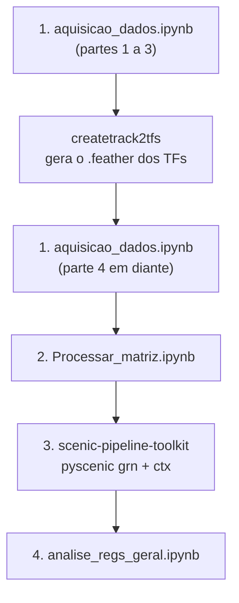

# Redes de regulação gênica em HepG2 com adição de ChIP-seq

Este é o repositório de entrada do trabalho. A partir dele é possível reproduzir todo o fluxo de análise, desde a aquisição dos dados públicos até a análise dos regulomas inferidos com pySCENIC, na linhagem hepática humana HepG2.

O fluxo passa por três repositórios. Este aqui reúne os notebooks de preparação e de análise, e os outros dois cuidam de etapas que exigem ambientes próprios: a construção dos bancos de rankings do cisTarget a partir de ChIP-seq e a execução do pySCENIC.

## Visão geral



| Ordem | Onde | O que faz |
|---|---|---|
| 1 | `aquisicao_dados.ipynb` (este repositório) | Obtém os dados necessários para a inferência da rede com GRNBoost2 e cisTarget |
| 1.1 | [createtrack2tfs](https://github.com/JVictorFFernandes/createtrack2tfs) | Gera o banco `.feather` de rankings a partir do ChIP-seq dos TFs selecionados |
| 2 | `Processar_matriz.ipynb` (este repositório) | Processa a matriz de expressão gênica usada pelo GRNBoost2 |
| 3 | [scenic-pipeline-toolkit](https://github.com/JVictorFFernandes/scenic-pipeline-toolkit) | Executa as etapas `grn` e `ctx` do pySCENIC |
| 4 | `analise_regs_geral.ipynb` (este repositório) | Analisa os regulomas obtidos |

Siga a ordem da tabela. Cada etapa depende de arquivos gerados pela anterior, então pular uma delas faz a seguinte falhar por falta de entrada.

## Requisitos gerais

Os três repositórios foram pensados para Linux. Quem usa Windows pode seguir pelo WSL2 com Ubuntu, que é o ambiente recomendado nos repositórios auxiliares. Também é preciso ter o Conda (Miniconda ou Mamba) instalado, porque a construção dos bancos do cisTarget e o pySCENIC usam ambientes separados com versões de bibliotecas incompatíveis entre si.

A etapa `grn` do pySCENIC consome bastante memória, sobretudo com 30 réplicas. Para reproduzir o trabalho completo, use um servidor ou uma máquina com RAM compatível; em notebook pessoal o processo tende a ser interrompido por falta de memória.

## Ambiente para os notebooks deste repositório

Os três notebooks daqui (`aquisicao_dados.ipynb`, `Processar_matriz.ipynb` e `analise_regs_geral.ipynb`) devem ser executados no ambiente Conda descrito em `environment.yml`, que fixa as versões das bibliotecas usadas nas análises. Crie o ambiente uma única vez, a partir da raiz do repositório:

```bash
conda env create -f environment.yml
```

O nome do ambiente é o que aparece no campo `name:` do `environment.yml`. Ative-o antes de abrir qualquer notebook:

```bash
conda activate <nome-do-ambiente>
```

Com o ambiente ativo, abra os notebooks pelo Jupyter iniciado nesse mesmo terminal. Se preferir o VS Code, selecione esse ambiente como kernel de cada notebook. Rodar os notebooks em outro ambiente pode trazer versões diferentes das bibliotecas e alterar os resultados.

Se o `environment.yml` for atualizado depois que o ambiente já existir, sincronize com:

```bash
conda env update -f environment.yml --prune
```

Esse ambiente vale apenas para os notebooks deste repositório. O createtrack2tfs e o scenic-pipeline-toolkit criam os próprios ambientes (`create_cistarget_databases`, `scenic` e `pycistarget`), e cada etapa deve rodar no ambiente indicado no respectivo repositório. Ao voltar deste repositório depois de usar um deles, lembre de reativar o ambiente dos notebooks.

## Passo a passo

### 1. Aquisição dos dados: `aquisicao_dados.ipynb`

Com o ambiente dos notebooks ativo, abra o notebook e execute as células em ordem até chegar à seção **"# 4. Bancos cisTarget customizados"**.

#### 1.1 Pausa para gerar o banco de rankings dos TFs

Antes de executar a parte 4, é preciso gerar o arquivo `.feather` com os rankings construídos a partir do ChIP-seq dos TFs selecionados. Isso é feito no repositório [createtrack2tfs](https://github.com/JVictorFFernandes/createtrack2tfs), que usa o pipeline oficial do Aerts Lab ([create_cisTarget_databases](https://github.com/aertslab/create_cisTarget_databases)).

Nesse repositório, siga o README do começo ao fim: preparar o ambiente Conda, instalar o Cluster-Buster e as ferramentas da UCSC, baixar o arquivo de regiões do hg38 e rodar o `create_cistarget_track_databases.py` sobre os arquivos `.bigWig` dos TFs.

Use o modo indicado para **SCENIC**, com o parâmetro `-g`. Ele agrega as regiões por gene e produz um banco de rankings do tipo tracks contra genes (por exemplo, `hg38_chipseq.tracks_vs_genes.rankings.feather`), que é o formato lido pelo `pyscenic ctx`. Sem o `-g`, o resultado é uma matriz de regiões contra tracks, formato do SCENIC+, que não serve para este fluxo.

Só volte ao notebook quando o arquivo `.feather` estiver gerado.

#### 1.2 Retomar a parte 4

Com o `.feather` em mãos, reative o ambiente dos notebooks e continue a execução de `aquisicao_dados.ipynb` a partir da parte 4 até o final.

### 2. Processamento da matriz: `Processar_matriz.ipynb`

Este notebook processa a matriz de expressão gênica que será a entrada do GRNBoost2. Execute todas as células em ordem. Ao final, a matriz estará pronta para ser usada pelo pySCENIC.

### 3. Inferência da rede: scenic-pipeline-toolkit

A inferência roda no repositório [scenic-pipeline-toolkit](https://github.com/JVictorFFernandes/scenic-pipeline-toolkit), que automatiza as etapas `grn` (GRNBoost2) e `ctx` (cisTarget) do pySCENIC. O README e o `GUIA_DO_USUARIO.md` desse repositório descrevem a instalação e a execução em detalhe. Em linhas gerais:

1. Instale os ambientes com `scripts/instalacao/install_pyscenic_pycistarget.sh` e confira com `scripts/instalacao/verify_installation.sh`.
2. Reúna numa mesma pasta os arquivos produzidos nas etapas anteriores. O gerador de configuração procura por:
   - um arquivo `.loom` com a matriz de expressão;
   - um arquivo `*tfs*.txt` com os reguladores candidatos;
   - os pares `.feather` + `.tbl` de cada TF, um para cada condição com ChIP-seq;
   - opcionalmente, um par genérico `.feather` + `.tbl` usado como condição de referência (apenas motivos).
3. Gere as configurações com `scripts/generate_configs.py`, informando a pasta de dados, o nome do projeto, a linhagem (`HepG2`) e o número de réplicas (`--replicates 30`, como no trabalho).
4. Execute `scripts/run_pyscenic_grn.sh` e, depois, `scripts/run_pyscenic_ctx.sh`.

As matrizes de adjacência ficam em `artefatos/<projeto>/HepG2/outs/adj/` e os regulomas em `artefatos/<projeto>/HepG2/outs/regs/`. Os logs de cada execução, com tempo, parâmetros e contagem de regulomas, ficam em `artefatos/<projeto>/HepG2/logs/`.

### 4. Análise dos resultados: `analise_regs_geral.ipynb`

Volte a este repositório, reative o ambiente dos notebooks e abra `analise_regs_geral.ipynb`. O notebook lê os regulomas gerados pela etapa `ctx` e produz as análises do trabalho, comparando a condição só com motivos às condições que acrescentam ChIP-seq.

## Estrutura deste repositório

```
.
├── aquisicao_dados.ipynb
├── Processar_matriz.ipynb
├── analise_regs_geral.ipynb
├── environment.yml
└── README.md
```

## Repositórios relacionados

- [createtrack2tfs](https://github.com/JVictorFFernandes/createtrack2tfs): construção dos bancos de rankings do cisTarget a partir de ChIP-seq.
- [scenic-pipeline-toolkit](https://github.com/JVictorFFernandes/scenic-pipeline-toolkit): instalação e execução automatizada do pySCENIC (`grn` e `ctx`) e do pycistarget.
- [pySCENIC](https://github.com/aertslab/pySCENIC) e [create_cisTarget_databases](https://github.com/aertslab/create_cisTarget_databases), ferramentas originais do Aerts Lab.
